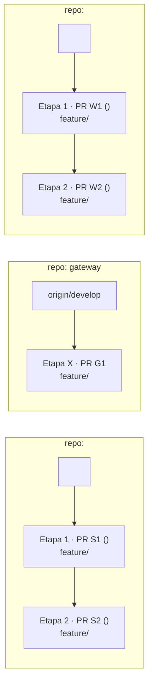

# Plantilla de Plan de Implementación — Discordia

Usá este esqueleto al redactar `implementation_plan.md`. Adaptá la cantidad de etapas y repositorios al alcance real, pero **no elimines** los bloques de commits atómicos, el plan de verificación, la etapa de publicación de PRs ni la etapa de cierre administrativo local.

---

`````markdown
# Plan de Implementación: <Título claro con alcance funcional y HUs involucradas>

## Descripción del Objetivo

<Resumen ejecutivo de qué se completa de punta a punta:>
1. **<HU-XX — Nombre de la historia>** (*<Obligatoria | Optativa>, <N> pts*): <qué resuelve y qué tarea `TSK-XXX` o pendiente cierra>.
2. **<Pre-requisito o HU sinérgica si aplica>**: <detalle breve>.
3. **Cierre administrativo local**: publicar los PRs correspondientes y actualizar `<TSK-XXX>` según `.agents/rules/backlog.md`. Actualizar `estado-historias.md` y sus puntajes sólo para las HUs que cumplan el criterio de cierre; el impacto previsto **<X> / 104 obligatorios** y **<Y> pts totales** es condicional.

---

## Decisiones de Diseño Acordadas (User Review Required)

> [!IMPORTANT]
> **Decisiones confirmadas e invariantes arquitectónicas**
> - **<Invariante de dominio / autorización 1>:** <Ej. comportamiento cuando `caller == target`, orden exacto de evaluación de rechazos en reglas de negocio>.
> - **<Invariante de persistencia / concurrencia 2>:** <Ej. migración Alembic/Flyway siguiendo patrón *expand/contract*, `lockById`, `flush()`, cascadas>.
> - **<Contrato entre servicios 3>:** <Ej. códigos de estado HTTP exactos, payloads y propagación en `gateway`>.
> - **Commits atómicos y sin rastro de IA:** Cada PR se divide en commits atómicos por cambio lógico (`docs`, `feat`, `test`) en formato Conventional Commits en español, sin trailers `Co-authored-by` ni leyendas generadas por IA.
> - **Privacidad del Backlog en repositorios compartidos:** Ningún archivo en `specs/`, `docs/arquitectura/`, mensajes de commit ni descripciones de PR mencionará `Backlog.json` ni identificadores `TSK-*` (solo referencias a `HU XX`, `ADR-XXX` o PRs de GitHub).
> - **Alcance de la aprobación:** Aprobar este plan autoriza la implementación, los commits, el push, la publicación de los PRs previstos y el seguimiento local, salvo límites expresos del usuario. Ante cambios materiales, decisiones no acordadas o bloqueos, detenerse e informar antes de continuar.

### Topología de Ramas y Pull Requests (<N> PRs en <M> etapas de código + publicación y cierre local)



> [!NOTE]
> <Si existen otros PRs abiertos en los mismos repositorios, explicar cómo se evitan conflictos de merge o por qué conviene apilar sobre determinada rama.>

### Dependencias operativas entre servicios *(si aplican)*

| Productor / consumidor | Contrato y versiones compatibles | Orden de despliegue | Rollback |
|---|---|---|---|
| <servicios y PRs relacionados> | <rutas, eventos, esquema, compatibilidad durante el rollout> | <pasos y precondiciones> | <procedimiento y límites de reversión> |

<Distinguir estas dependencias del apilamiento Git; indicar migraciones expand/contract, configuración y riesgos de versiones mixtas cuando corresponda.>

---

## Cambios Propuestos por Etapa

### Etapa 1 — <Nombre de la Etapa / HU> (`<repo-1>` + `<repo-2>`)

#### Repositorio `<repo-1>` (rama `feature/<slug>` desde `<rama-base>`)

##### [NEW] `docs/arquitectura/adr-<NNN>-<slug>.md` *(si hay decisión arquitectónica local; si es transversal, documentar en `infra/docs/adr/`)*
- Contexto, Decisiones, Alternativas descartadas, Orden de errores / invariantes y Consecuencias (siguiendo el formato de los ADRs previos del servicio).

##### [NEW] `specs/<NNN>-<slug>/spec.md` (y `contracts/<api>.md`, `data-model.md` según convención del repo)
- Especificación SDD imitando las specs existentes de `<repo-1>` (`Contexto`, `User Scenarios & Testing`, `Functional Requirements`). Sin referencias a `TSK-*` ni `Backlog.json`.

##### [NEW / MODIFY] [<ArchivoDeDominioORepositorio>](file:///ruta/absoluta/al/archivo)
- Detalle concreto de cambios y, cuando apliquen, firmas, migraciones, códigos y payloads de error y precedencia justificada de validaciones solapadas.

##### [NEW / MODIFY] [<ArchivoDeTest>](file:///ruta/absoluta/al/test)
- Casos unitarios y de integración a cubrir (camino feliz, bordes, jerarquía/permisos, concurrencia/esquema).

**Secuencia de commits atómicos prevista (`<repo-1>`):**
1. `docs(<scope>): spec, contratos y adr de <funcionalidad> (HU-XX)`
2. `feat(<scope>): migracion <V# / alembic> para <cambio de esquema>` *(si aplica)*
3. `feat(<scope>): <caso de uso, reglas de dominio y endpoint>`
4. `test(<scope>): pruebas unitarias e integracion de <funcionalidad>`

---

#### Repositorio `<web-client | gateway | otro>` (rama `feature/<slug>` desde `<rama-base>`)

##### [NEW] `specs/<NNN>-<slug>/spec.md` (y `contracts/<ui>.md` si aplica)
- Especificación SDD del cliente / gateway alineada con los contratos del backend.

##### [NEW / MODIFY] [<ClienteApiYMapeoDeErrores>](file:///ruta/absoluta/al/archivo)
- Funciones de cliente HTTP/WS y comportamiento ante errores conocidos y desconocidos, con mensajes localizados según las convenciones existentes y sin exigir traducción literal 1:1.

##### [NEW / MODIFY] [<ComponentesUI>](file:///ruta/absoluta/al/componente)
- Estados visuales, accesibilidad (`accessibilityLabel`, `testID`), deshabilitación preventiva según permisos/jerarquía y actualización local del estado.

##### [NEW / MODIFY] [<TestsDeCliente>](file:///ruta/absoluta/al/test)
- Pruebas de API, mapeo de errores y componentes.

**Secuencia de commits atómicos prevista (`<repo-2>`):**
1. `docs(<scope>): spec y contratos de <funcionalidad> (HU-XX)`
2. `feat(<scope>): cliente api y mapeo de errores para <funcionalidad>`
3. `feat(<scope>): <componentes y controles de interfaz>`
4. `test(<scope>): pruebas de <funcionalidad> en api y componentes`

---

<!-- Repetir la misma estructura para Etapa 2, Etapa 3, etc. -->

## Plan de Verificación

### 1. Tests Automatizados y Linters

<Verificar scripts, configuración y comandos reales de cada repositorio y declarar los comandos concretos para cada rama. Ejecutar pruebas dirigidas durante la iteración; antes de publicar, ejecutar suite completa, lint y tipos aplicables al estado final de cada PR, reutilizando resultados sólo para el mismo SHA. No ejecutar la suite completa por cada commit.>

- **Python:** `ruff` sin errores y cobertura >= 70% en la suite completa antes del PR; usar la configuración y el entorno del servicio. En `profile`, incluir `behave` si se tocaron escenarios BDD.
- **`server`:** ejecutar tests y chequeos aplicables con `_JAVA_OPTIONS=-Duser.timezone=UTC`; documentar requisitos como Docker.
- **Clientes Expo:** comprobar scripts en cada `package.json` antes de planificar lint, tipos y tests. Si falta un runner o script, informar la limitación y acordar cómo obtener evidencia; no afirmar que se ejecutaron tests inexistentes.
- <Registrar comandos, SHA, resultados y cobertura real; si un gate obligatorio falla o no puede ejecutarse, detener la publicación e informar.>

### 2. Auditoría de Atomicidad, Autoría y Privacidad (previa al `git push`)

En cada rama creada, verificar antes de subir cambios:
```powershell
git -C <repo> log <rama-base>..HEAD --oneline
git -C <repo> log <rama-base>..HEAD --format="%B"
git -C <repo> diff <rama-base>...HEAD
```
- Confirmar commits atómicos en español (Conventional Commits) y **cero** trailers `Co-authored-by` o firmas de IA.
- Confirmar **cero** apariciones de `TSK-` o `Backlog.json` en commits, `specs/`, `docs/` y código.

### 3. Verificación Manual / Integración Punta a Punta

1. Levantar stack local (`infra/script/startup-infra.sh` + `infra/script/startup-servers.sh`) y cliente (`npx expo start --web`).
2. <Relacionar cada CA de la HU con pasos o pruebas de integración de punta a punta y resultados esperados, incluidos rechazos y casos borde aplicables>.
3. <Registrar resultados, entorno y limitaciones; no inferir despliegue de producción a partir de pruebas locales>.

---

### Etapa <N-1> — Publicación de Pull Requests (Obligatoria una vez validado todo lo anterior)

Con todos los linters, tests y auditorías en verde, subir las ramas en **orden topológico** (primero ramas base, luego ramas apiladas) y crear los Pull Requests mediante GitHub CLI en **PowerShell** (`gh pr create`):

| Orden | Repositorio | Rama (`--head`) | Base (`--base`) | Título del PR |
|------:|-------------|-----------------|-----------------|---------------|
| 1 | `<repo>` | `feature/<slug-1>` | `<develop o rama-base>` | `feat(<scope>): <descripción breve en español>` |
| 2 | `<repo>` | `feature/<slug-2>` | `feature/<slug-1>` | `feat(<scope>): <descripción breve en español> (HU-XX)` |

Cada PR debe usar la **plantilla obligatoria de `AGENTS.md`** (sin mencionar `TSK-*`/`Backlog.json` ni firmas de IA):
- `## Resumen` (qué resuelve y referencia a `HU-XX` / `ADR-XXX`).
- `## Cambios principales` (agrupados por capa o módulo).
- `## Contratos e Impacto Operativo` (`APIs / Eventos`, `Base de datos`, `Configuración / Infra`, `PRs relacionados / apilados`).
- `## Verificación` (checks marcados `[x]` con los comandos y resultados reales ejecutados).

Antes de cada push y creación, comprobar remoto, SHA, cabeza y base y consultar si ya existe el PR. Ante una interrupción, informar lo publicado y lo pendiente; al retomar, verificar el estado remoto y reutilizar el PR coincidente sin duplicarlo. No forzar push ni reescribir historia sin autorización expresa.

---

### Etapa <N> — Cierre de Backlog y Actualización de Estado de Historias

El seguimiento de inicio se registra al comenzar el trabajo; el cierre se realiza recién una vez creados los PRs necesarios y obtenidos sus números reales (`#<N>`):

##### [MODIFY] `Backlog.json`
Siguiendo el protocolo en `.agents/rules/backlog.md` (lectura completa, modificación sobre el objeto parseado, actualización de `last_updated`, serialización `JSON.stringify(data, null, 2) + "\n"` y re-parseo de verificación):
- Al iniciar el trabajo, registrar `in_progress` y la fecha real de inicio si `start_date` es `null`; nunca cambiar una fecha existente.
- Al finalizar, localizar `<TSK-XXX>` por ID y actualizar `status: "completed"` y `pull_request: "<repo> #<N>; ..."` sólo para trabajo terminado. Aplicar las excepciones sin PR previstas en el protocolo cuando correspondan.
- Registrar trabajo adicional descubierto en `discovered_pending_tasks` de la tarea de origen, con `description`, `severity` y `resolved`; no crear automáticamente una tarea raíz. Las tareas nuevas solicitadas explícitamente siguen el protocolo aplicable.
- Verificar tras cada escritura que el JSON parsea y que la cantidad e IDs de tareas no cambiaron accidentalmente.

##### [MODIFY] `estado-historias.md`
- Sólo marcar una HU como completada y sumar sus puntos si todos sus PRs necesarios están abiertos o mergeados y todos sus CA fueron verificados de punta a punta; registrar evidencia y entorno. Un PR abierto no implica despliegue.
- Para las HUs que cumplan ese criterio, mover/agregar a la tabla correspondiente, recalcular subtotales y puntaje total y actualizar las notas. Si falta evidencia, conservar el estado parcial o pendiente y explicar qué falta.
`````
